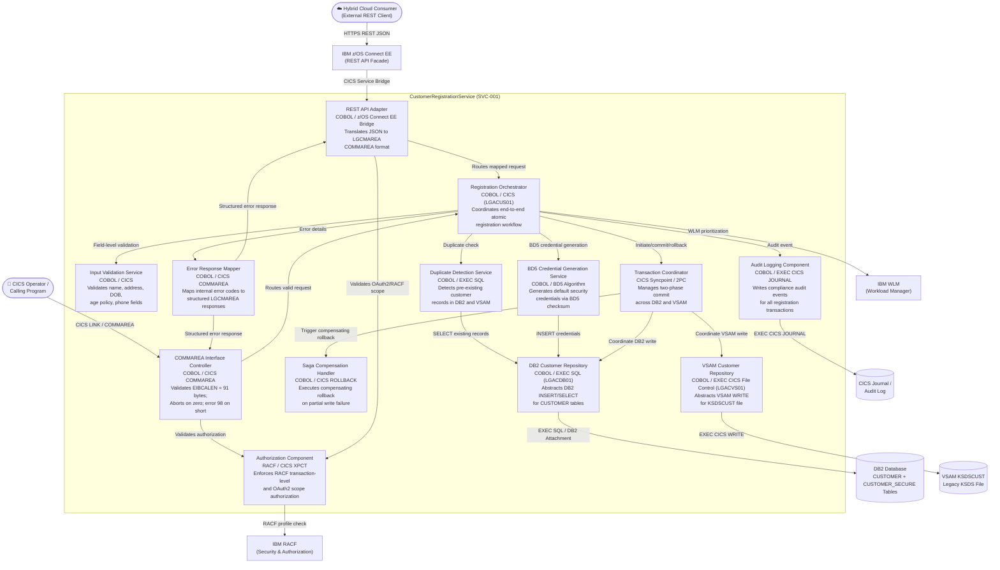
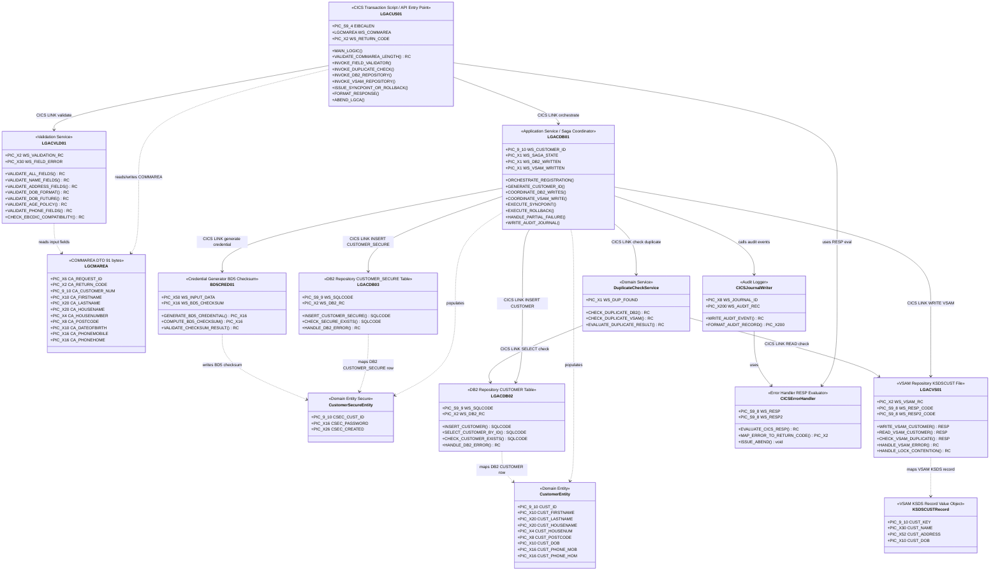

# CustomerRegistrationService

## C3 — Summary

The C3 Component Diagram for CustomerRegistrationService (SVC-001) illustrates the internal logical architecture of the end-to-end atomic customer registration workflow on IBM Z (zSeries). The service is bounded by a single CICS-managed transaction boundary and exposes two entry points: a COMMAREA Interface Controller for native CICS callers (validating EIBCALEN = 91 bytes per LGCMAREA copybook) and a REST API Adapter for hybrid cloud consumers via IBM z/OS Connect EE. The Registration Orchestrator (LGACUS01) coordinates the sequential workflow: Input Validation Service enforces all field-level rules (name, address, DOB format, age policy ≥18 years, optional phone fields), Duplicate Detection Service queries DB2 for pre-existing records, and BD5 Credential Generation Service produces default security credentials. The Transaction Coordinator manages CICS syncpoint two-phase commit across the DB2 Customer Repository (LGACDB01) and VSAM Customer Repository (LGACVS01), ensuring atomic writes to DB2 CUSTOMER, DB2 CUSTOMER_SECURE, and VSAM KSDSCUST. The Saga Compensation Handler executes compensating rollback logic on any partial failure. Cross-cutting concerns are handled by the Authorization Component (RACF/CICS XPCT), Error Response Mapper (LGCMAREA error codes), and Audit Logging Component (CICS Journal / IBM Z System Logger). External dependencies include IBM DB2 for z/OS, VSAM KSDSCUST, IBM RACF, IBM WLM, IBM z/OS Connect EE, and the CICS Journal audit infrastructure.

## C3 — Insights

- The COMMAREA Interface Controller enforces a strict 91-byte EIBCALEN boundary check (US-001) as the first gate, aborting with ABCODE LGCA on zero-length COMMAREA and returning error code 98 on insufficient length — this prevents any downstream processing on malformed requests.
- The Input Validation Service implements a sequential validation pipeline covering six user stories (US-001 through US-006): COMMAREA length, name fields (FIRSTNAME/LASTNAME), address fields (HOUSENAME/HOUSENUMBER/POSTCODE), date of birth format and future-date check, age policy (minimum 18 years), and optional phone fields — all with field-specific error codes and EBCDIC compatibility checks for VSAM KSDSCUST.
- The Transaction Coordinator implements CICS syncpoint two-phase commit across heterogeneous data stores (DB2 and VSAM), satisfying the ACID transaction requirement for the multi-store write pattern. This is the critical architectural mechanism ensuring consistency between DB2 CUSTOMER, DB2 CUSTOMER_SECURE, and VSAM KSDSCUST.
- The Saga Compensation Handler provides compensating rollback logic for partial failure scenarios (e.g., VSAM KSDSCUST unavailability, DB2 connection timeout), implementing the Saga pattern to maintain eventual consistency when CICS two-phase commit cannot atomically cover all stores.
- The BD5 Credential Generation Service is architecturally isolated as a dedicated component, enabling future replacement with a cryptographically stronger algorithm during modernization without impacting the orchestration or persistence layers — a key Strangler Fig transition concern.
- The REST API Adapter implements the Adapter/Sidecar pattern, translating JSON payloads from hybrid cloud consumers (via IBM z/OS Connect EE) into CICS COMMAREA format, enabling cloud-native integration without modifying the proven COBOL/CICS transaction script internals.
- The Duplicate Detection Service queries DB2 CUSTOMER table before any write operations, preventing duplicate registrations as required by F-01. This check is positioned after validation but before credential generation and persistence to minimize unnecessary DB2 load on invalid requests.
- The Authorization Component enforces dual-mode authorization: RACF transaction-level profiles (CICS XPCT) for native CICS callers and OAuth2 scope-to-RACF mapping for API gateway consumers — ensuring consistent security posture across both entry points.
- The Audit Logging Component is a cross-cutting concern that captures all registration lifecycle events (attempt, success, validation failure, rollback) via EXEC CICS JOURNAL, feeding IBM Z System Logger for compliance-grade tamper-evident audit trails required for GDPR and SOX.
- The separation of DB2 Customer Repository (LGACDB01) and VSAM Customer Repository (LGACVS01) as distinct components implements the Repository Pattern, decoupling business logic from data store specifics and enabling future VSAM-to-DB2 migration without impacting the orchestration layer — aligned with the long-term data management strategy.

## C3 — Interfaces

### CICS COMMAREA Registration Interface (CICS COMMAREA / COBOL)
Native CICS entry point for internal callers invoking the customer registration transaction via LGCMAREA copybook. Enforces 91-byte COMMAREA length validation as the primary interface contract.

- EXEC CICS LINK PROGRAM('LGACUS01') COMMAREA(LGCMAREA) LENGTH(91)
- EIBCALEN validation: abort with ABCODE LGCA if EIBCALEN = 0
- EIBCALEN validation: return error code 98 if EIBCALEN < 91
- EIBCALEN validation: proceed to field validation if EIBCALEN = 91
- Return structured LGCMAREA response with transaction status and error codes

### RESTful Registration API (Modernization Facade) (REST / HTTPS / JSON / IBM z/OS Connect EE)
RESTful HTTP API exposed via IBM z/OS Connect EE for hybrid cloud consumers to submit customer registration requests. Translates JSON payloads to CICS COMMAREA format internally.

- POST /api/v1/customers/register - Submit new customer registration request
- GET /api/v1/customers/register/status/{transactionId} - Retrieve registration transaction status
- OAuth2 Bearer token validation on all endpoints
- JSON request body: firstName, lastName, houseName, houseNumber, postCode, dateOfBirth, phoneMobile, phoneHome
- JSON response: customerId, status, errorCode, errorMessage

### Input Validation Interface (CICS LINK / COBOL / COMMAREA)
Internal interface for sequential field-level validation of customer demographic data covering all mandatory and optional fields with EBCDIC compatibility and business rule enforcement.

- ValidateNameFields: FIRSTNAME presence, DB2 length limit, EBCDIC compatibility
- ValidateNameFields: LASTNAME presence, DB2 length limit, EBCDIC compatibility
- ValidateAddressFields: HOUSENAME presence, DB2 length limit, EBCDIC compatibility
- ValidateAddressFields: HOUSENUMBER presence, DB2 length limit, EBCDIC compatibility
- ValidateAddressFields: POSTCODE presence, DB2 length limit, EBCDIC compatibility
- ValidateDateOfBirth: format validation, future date check, DB2 length limit, EBCDIC compatibility
- ValidateAgePolicy: calculated age >= 18 years from DATEOFBIRTH
- ValidatePhoneFields: PHONEMOBILE optional, numeric format, DB2 length limit
- ValidatePhoneFields: PHONEHOME optional, numeric format, DB2 length limit
- Return field-specific error codes on validation failure

### Duplicate Detection Interface (EXEC SQL / CICS DB2 Attachment Facility)
Internal interface for querying existing customer records in DB2 to detect and prevent duplicate customer registrations before any write operations are initiated.

- CheckDuplicateByName: SELECT from DB2 CUSTOMER WHERE FIRSTNAME = :fname AND LASTNAME = :lname
- CheckDuplicateByAddress: SELECT from DB2 CUSTOMER WHERE HOUSENAME = :hname AND POSTCODE = :pcode
- ReturnDuplicateIndicator: return DUPLICATE-FOUND or NOT-FOUND status to orchestrator
- Block registration processing if duplicate detected

### BD5 Credential Generation Interface (COBOL / BD5 Checksum Algorithm)
Internal interface for generating default security credentials using the BD5 checksum algorithm applied to customer demographic input data.

- GenerateCredential: apply BD5 checksum algorithm to customer demographic fields
- ReturnCredentialPayload: return generated password hash and credential metadata
- HandleBD5Failure: return BD5 algorithm failure error code to orchestrator on exception

### DB2 Customer Repository Interface (EXEC SQL / CICS DB2 Attachment Facility / COBOL)
Data access interface for all DB2 operations on the CUSTOMER and CUSTOMER_SECURE tables, including INSERT for new records, SELECT for duplicate detection, and participation in CICS two-phase commit.

- INSERT INTO CUSTOMER (FIRSTNAME, LASTNAME, HOUSENAME, HOUSENUMBER, POSTCODE, DATEOFBIRTH, PHONEMOBILE, PHONEHOME)
- INSERT INTO CUSTOMER_SECURE (CUSTOMERID, PASSWORDHASH, CREDENTIALMETADATA)
- SELECT FROM CUSTOMER WHERE key fields for duplicate detection
- EXEC CICS SYNCPOINT for two-phase commit participation
- Handle SQLCA error codes: SQLCODE -803 duplicate key, SQLCODE -911 deadlock, SQLCODE -904 resource unavailable
- Return structured DB2 error response to orchestrator

### VSAM Customer Repository Interface (EXEC CICS File Control / COBOL / VSAM KSDS)
Data access interface for all VSAM KSDS file control operations on the KSDSCUST file, including WRITE for new customer records and participation in CICS syncpoint coordination.

- EXEC CICS WRITE FILE('KSDSCUST') FROM(CUST-RECORD) RIDFLD(CUST-KEY)
- EXEC CICS SYNCPOINT for transaction coordination
- Handle RESP DUPREC for duplicate key detection on VSAM
- Handle RESP NOTOPEN for VSAM file unavailability
- Handle RESP LOCKED for VSAM lock contention on KSDSCUST
- Return structured VSAM error response to orchestrator

### Transaction Coordinator Interface (CICS Syncpoint API / Two-Phase Commit)
Interface for managing CICS syncpoint two-phase commit coordination across DB2 and VSAM data stores, including commit on success and rollback with Saga compensation on failure.

- EXEC CICS SYNCPOINT - commit all resource manager updates atomically
- EXEC CICS SYNCPOINT ROLLBACK - rollback all updates on failure
- InvokeSagaCompensation: trigger compensating handler on partial failure
- CoordinateDB2Write: sequence DB2 repository write within UoW
- CoordinateVSAMWrite: sequence VSAM repository write within UoW

### Audit Logging Interface (EXEC CICS JOURNAL / IBM Z System Logger / COBOL)
Cross-cutting audit interface for writing compliance-grade transaction audit events to the CICS journal and IBM Z System Logger for all registration lifecycle events.

- EXEC CICS JOURNAL JFILEID('AUDITLOG') FROM(AUDIT-RECORD) - write registration attempt event
- LogRegistrationSuccess: write successful registration audit record with customer ID
- LogValidationFailure: write field-specific validation failure audit record
- LogDuplicateDetected: write duplicate detection audit record
- LogTransactionRollback: write rollback event with failure reason
- LogSagaCompensation: write compensating transaction execution record

### Authorization Interface (IBM RACF / CICS XPCT / OAuth2)
Security interface enforcing RACF transaction-level authorization for CICS callers and OAuth2 scope validation for API gateway consumers before any registration processing.

- ValidateRACFTransactionProfile: check CICS XPCT resource class for registration transaction
- ValidateOAuth2Scope: map OAuth2 Bearer token scope to RACF authorization profile
- EnforceMinimalPrivilege: verify caller has only required RACF grants
- ReturnAuthorizationDenied: return authorization failure to entry point on rejection

## C3 — Relationships

- ? -> ?: Submits customer registration request via HTTPS REST JSON
- ? -> ?: Forwards translated request via CICS Service Bridge
- ? -> ?: Invokes registration transaction via CICS LINK with 91-byte LGCMAREA COMMAREA
- ? -> ?: Validates RACF transaction-level authorization before routing
- ? -> ?: Validates OAuth2 scope mapped to RACF profile
- ? -> ?: Checks RACF profiles and CICS XPCT resource class
- ? -> ?: Routes validated COMMAREA request to orchestrator
- ? -> ?: Routes mapped COMMAREA request to orchestrator
- ? -> ?: Delegates sequential field-level validation
- ? -> ?: Requests duplicate customer check before persistence
- ? -> ?: Requests BD5 credential generation after validation
- ? -> ?: Initiates, commits, or rolls back CICS two-phase commit transaction
- ? -> ?: Sends error details for structured LGCMAREA response mapping
- ? -> ?: Publishes registration lifecycle audit events
- ? -> ?: Transaction prioritized by WLM HIGH service class
- ? -> ?: Queries DB2 CUSTOMER table for existing records via SELECT
- ? -> ?: Persists generated credentials to DB2 CUSTOMER_SECURE via INSERT
- ? -> ?: Coordinates DB2 write within CICS unit-of-work boundary
- ? -> ?: Coordinates VSAM write within CICS syncpoint boundary
- ? -> ?: Triggers Saga compensating rollback on partial write failure
- ? -> ?: Reads and writes CUSTOMER and CUSTOMER_SECURE tables via EXEC SQL
- ? -> ?: Writes customer record to KSDSCUST via EXEC CICS WRITE File Control
- ? -> ?: Writes tamper-evident audit trail entries via EXEC CICS JOURNAL
- ? -> ?: Returns structured LGCMAREA error response to CICS caller
- ? -> ?: Returns structured JSON error response to REST API adapter

## C3 — External dependencies

- IBM DB2 for z/OS: Primary relational data store hosting CUSTOMER table (demographic records) and CUSTOMER_SECURE table (security credentials). Participates in CICS two-phase commit. System of record for customer data.
- VSAM KSDSCUST: Legacy key-sequenced dataset storing customer records for legacy compatibility. Write target during registration; participates in CICS syncpoint coordination. Long-term migration candidate to DB2.
- CICS Journal / Audit Log: Tamper-evident audit trail infrastructure capturing all registration transaction lifecycle events for compliance, forensic investigation, and regulatory reporting.
- IBM RACF: Security and access control system enforcing transaction-level authorization for CICS registration transactions and dataset access. Provides RACF profile validation for both native CICS and OAuth2-mapped API consumers.
- IBM WLM: Workload Manager enforcing HIGH priority service class for registration transactions to meet SLA requirements under concurrent load.
- IBM z/OS Connect EE: RESTful API facade and CICS service bridge enabling hybrid cloud consumers to invoke the CustomerRegistrationService without direct CICS knowledge. Handles JSON-to-COMMAREA translation and OAuth2 token validation.

## C3 — Diagram

## C4 — Classes

- LGACUS01
- LGCMAREA
- LGACDB01
- LGACVLD01
- BD5CRED01
- CustomerEntity
- CustomerSecureEntity
- DuplicateCheckService
- LGACDB02
- LGACDB03
- LGACVS01
- KSDSCUSTRecord
- CICSJournalWriter
- CICSErrorHandler

## C4 — Summary

This C4 Code diagram details the internal class-level structure of the CustomerRegistrationService (SVC-001) running on IBM z/OS CICS. The diagram is organized into four layers: (1) Presentation — LGACUS01 acts as the CICS transaction entry point and z/OS Connect EE API facade, receiving the 91-byte LGCMAREA COMMAREA; (2) Application — LGACDB01 serves as the Saga Coordinator orchestrating multi-store writes with CICS SYNCPOINT/ROLLBACK, LGACVLD01 implements the sequential field-validation chain (COMMAREA length → name → address → DOB format → DOB future → age ≥18 → phone), and BD5CRED01 generates default security credentials; (3) Domain — CustomerEntity, CustomerSecureEntity, and DuplicateCheckService encapsulate core business rules; (4) Infrastructure — LGACDB02 (DB2 CUSTOMER), LGACDB03 (DB2 CUSTOMER_SECURE), and LGACVS01 (VSAM KSDSCUST) implement the Repository Pattern for heterogeneous data stores. Cross-cutting concerns are handled by CICSJournalWriter (audit) and CICSErrorHandler (RESP evaluation and ABEND management). All inter-program calls use CICS LINK with standardized COMMAREA interfaces, and atomicity across all three data stores is enforced via CICS two-phase commit (Saga Pattern P-03).

## C4 — Insights

- LGACUS01 is the sole CICS transaction entry point and enforces the 91-byte EIBCALEN boundary contract (US-001): ABEND 'LGCA' on zero-length COMMAREA and RC '98' on under-length COMMAREA, before any field validation or persistence is attempted.
- LGACVLD01 implements a strict sequential validation chain — COMMAREA length → name fields (US-002) → address fields (US-003) → DOB format/future date (US-004) → age ≥18 policy (US-005) → optional phone fields (US-006) — each step returning a field-specific error code and halting further processing on failure, satisfying all EP-001 acceptance criteria.
- LGACDB01 acts as the Saga Coordinator (Pattern P-03): it tracks WS-SAGA-STATE, WS-DB2-WRITTEN, and WS-VSAM-WRITTEN flags to determine whether to issue CICS SYNCPOINT (all three stores written) or CICS SYNCPOINT ROLLBACK (any partial failure), ensuring ACID atomicity across DB2 CUSTOMER, DB2 CUSTOMER_SECURE, and VSAM KSDSCUST.
- The Repository Pattern (P-02) is realized by three dedicated COBOL programs — LGACDB02 (DB2 CUSTOMER), LGACDB03 (DB2 CUSTOMER_SECURE), LGACVS01 (VSAM KSDSCUST) — each encapsulating all data access for its store and exposing a standardized COMMAREA interface with return code and SQLCODE/RESP fields, decoupling business logic from storage technology.
- BD5CRED01 is isolated as a dedicated credential-generation program, encapsulating the BD5 checksum algorithm. This isolation means a BD5 algorithm failure is a discrete, catchable error that triggers SYNCPOINT ROLLBACK without corrupting the saga state of other writes.
- DuplicateCheckService queries both LGACDB02 (DB2 SELECT) and LGACVS01 (VSAM READ) before any INSERT is attempted, implementing cross-store duplicate detection as required by F-01 and preventing partial duplicate records across heterogeneous stores.
- LGACVS01 explicitly handles VSAM lock contention (HANDLE_LOCK_CONTENTION) and file unavailability as distinct error paths, mapping them to specific return codes that LGACDB01 uses to decide between retry and rollback — addressing the VSAM exception scenarios in F-01.
- CICSJournalWriter uses EXEC CICS JOURNAL to write tamper-evident audit records for every registration attempt (success and failure), satisfying Pattern P-10 (Audit Logging) and providing the forensic trail required for GDPR/SOX compliance.
- The LGCMAREA COMMAREA (91 bytes, per LGCMAREA copybook) is the sole data contract between the z/OS Connect EE API facade and the CICS transaction internals, enabling the Strangler Fig modernization (P-07) — the external REST API surface can evolve independently of the COBOL COMMAREA interface.
- All inter-program communication uses CICS LINK (not CALL), ensuring each sub-program runs within the same CICS unit-of-work and participates in the two-phase commit scope managed by LGACDB01, which is critical for the atomicity guarantee across DB2 and VSAM resource managers.

## C4 — Methods

- **LGACUS01.?** — Checks EIBCALEN: if zero, calls ABEND-LGCA(); if less than 91, sets RC '98' and returns; if exactly 91, proceeds. Implements US-001 boundary conditions BR-LGACDB01-001 and BR-LGACDB01-002.
- **LGACUS01.?** — Issues EXEC CICS ABEND ABCODE('LGCA') and writes 'NO COMMAREA RECEIVED' error message. Triggered when EIBCALEN equals zero.
- **LGACUS01.?** — Delegates to LGACDB01 saga coordinator result: issues EXEC CICS SYNCPOINT on success or EXEC CICS SYNCPOINT ROLLBACK on any failure, ensuring atomicity across all three data stores.
- **LGACVLD01.?** — Validates FIRSTNAME and LASTNAME for presence, DB2 CUSTOMER column length limits, and EBCDIC compatibility for VSAM KSDSCUST mapping. Returns field-specific error code on failure.
- **LGACVLD01.?** — Validates HOUSENAME, HOUSENUMBER, and POSTCODE for presence, DB2 column length limits, and EBCDIC compatibility. Returns field-specific error code identifying the failing field and constraint.
- **LGACVLD01.?** — Validates DATEOFBIRTH for valid date format, DB2 column length compliance, and EBCDIC compatibility for VSAM KSDSCUST CUST-DOB mapping.
- **LGACVLD01.?** — Checks that DATEOFBIRTH is not a future date relative to current system date. Returns invalid date error if future date detected.
- **LGACVLD01.?** — Calculates customer age from DATEOFBIRTH against current date. Returns age policy violation error if calculated age is less than 18 years.
- **LGACVLD01.?** — Validates optional PHONEMOBILE and PHONEHOME fields: allows blank/null, but rejects values exceeding DB2 length limits or containing non-numeric characters.
- **LGACDB01.?** — Top-level saga orchestration method: calls duplicate check, generates customer ID, invokes BD5 credential generation, coordinates three sequential repository writes, and determines SYNCPOINT or ROLLBACK outcome.
- **LGACDB01.?** — Issues EXEC CICS SYNCPOINT after all three data store writes (DB2 CUSTOMER, DB2 CUSTOMER_SECURE, VSAM KSDSCUST) have been confirmed successful. Commits the two-phase commit transaction.
- **LGACDB01.?** — Issues EXEC CICS SYNCPOINT ROLLBACK to reverse all partial writes when any data store operation fails. Implements compensating transaction logic for the Saga pattern.
- **BD5CRED01.?** — Entry point for BD5 credential generation. Accepts customer demographic input, invokes COMPUTE-BD5-CHECKSUM, validates the result, and returns the 16-character credential for storage in CUSTOMER_SECURE.
- **DuplicateCheckService.?** — Executes SELECT against DB2 CUSTOMER table via LGACDB02 to detect existing customer records before INSERT. Returns duplicate-found flag.
- **DuplicateCheckService.?** — Executes READ against VSAM KSDSCUST file via LGACVS01 to detect existing KSDS records before WRITE. Returns duplicate-found flag.
- **LGACVS01.?** — Handles VSAM KSDSCUST file lock contention (RESP DUPREC / NOTOPEN conditions). Maps CICS RESP codes to specific return codes that LGACDB01 uses to trigger SYNCPOINT ROLLBACK.
- **CICSJournalWriter.?** — Issues EXEC CICS JOURNAL to write a structured audit record for each registration event (attempt, success, failure, rollback). Feeds IBM Z System Logger for compliance audit trail.

## C4 — Data structures

- LGCMAREA: The sole data contract between calling applications and the CICS registration transaction. Defined by the LGCMAREA copybook. Contains all input fields for customer registration and the output return code. Validated for exact 91-byte length per US-001.
- CustomerEntity: In-memory representation of a DB2 CUSTOMER table row. Populated by LGACDB01 from LGCMAREA fields after successful validation. Used as the source structure for LGACDB02 INSERT operations.
- CustomerSecureEntity: In-memory representation of a DB2 CUSTOMER_SECURE table row. Populated after BD5CRED01 generates the password checksum. Used as the source structure for LGACDB03 INSERT operations.
- KSDSCUSTRecord: Fixed-length VSAM record layout for the KSDSCUST KSDS file. CUST-KEY is the primary key for KSDS access. All character fields must be EBCDIC-compatible as validated by LGACVLD01.
- WS-SAGA-STATE: Working-storage flags in LGACDB01 tracking the saga execution state: WS-DB2-WRITTEN (DB2 CUSTOMER written), WS-VSAM-WRITTEN (VSAM KSDSCUST written), WS-SAGA-STATE (overall saga phase). Used to determine compensating rollback scope.
- WS-VALIDATION-RESULT: Working-storage structure in LGACVLD01 capturing the validation outcome: return code and field-specific error description. Passed back to LGACUS01 via COMMAREA on validation failure.
- WS-AUDIT-RECORD: Fixed-length audit record written by CICSJournalWriter via EXEC CICS JOURNAL. Contains transaction ID, user ID, timestamp, operation type, customer number, and outcome code for compliance logging.

## C4 — Code relationships

- LGACUS01 receives the 91-byte LGCMAREA as DFHCOMMAREA from the calling application. Reads all input fields and writes CA-RETURN-CODE and CA-CUSTOMER-NUM as output. This is the primary API contract.
- LGACUS01 delegates all field-level validation to LGACVLD01 after COMMAREA length check passes. Passes a validation sub-COMMAREA and receives field-specific error codes.
- After successful validation, LGACUS01 delegates saga orchestration to LGACDB01. LGACDB01 runs within the same CICS unit-of-work, enabling two-phase commit participation.
- LGACDB01 invokes DuplicateCheckService before any INSERT to detect existing records across DB2 and VSAM. A duplicate-found result aborts the saga without any writes.
- LGACDB01 invokes BD5CRED01 to generate the default security credential before writing to CUSTOMER_SECURE. BD5 failure triggers SYNCPOINT ROLLBACK.
- LGACDB01 invokes LGACDB02 to INSERT a row into DB2 CUSTOMER table. SQLCODE is checked; non-zero SQLCODE sets WS-DB2-WRITTEN=N and triggers rollback.
- LGACDB01 invokes LGACDB03 to INSERT a row into DB2 CUSTOMER_SECURE table after successful BD5 credential generation. Failure triggers SYNCPOINT ROLLBACK.
- LGACDB01 invokes LGACVS01 to WRITE a record to VSAM KSDSCUST. RESP code is checked; non-zero RESP triggers SYNCPOINT ROLLBACK and compensating logic.
- DuplicateCheckService uses LGACDB02 in SELECT mode to check for existing customer records in DB2 CUSTOMER before any INSERT is attempted.
- DuplicateCheckService uses LGACVS01 in READ mode to check for existing KSDS records in VSAM KSDSCUST before any WRITE is attempted.
- LGACDB02 maps CustomerEntity working-storage fields to DB2 CUSTOMER table columns via DCLGEN-generated host variable declarations for embedded SQL INSERT and SELECT statements.
- LGACDB03 maps CustomerSecureEntity fields to DB2 CUSTOMER_SECURE table columns via DCLGEN host variables for embedded SQL INSERT.
- LGACVS01 uses KSDSCUSTRecord as the INTO/FROM buffer for EXEC CICS READ/WRITE FILE('KSDSCUST') operations, with CUST-KEY as the RIDFLD.
- LGACDB01 calls CICSJournalWriter at key saga milestones (start, each store write, SYNCPOINT, ROLLBACK) to write audit records for compliance logging.
- LGACUS01 uses CICSErrorHandler logic (via COPY member or inline) to evaluate CICS RESP codes from all EXEC CICS calls and map them to standardized CA-RETURN-CODE values.

## C4 — Diagram

## API specification — Endpoints

### POST /api/v1/customers/registrations
Orchestrates the end-to-end atomic customer registration workflow. Captures, validates, and persists new customer demographic data (name, address, date of birth, optional phone numbers) across DB2 CUSTOMER table, DB2 CUSTOMER_SECURE table, and VSAM KSDSCUST file within a single CICS-managed two-phase commit transaction boundary. Performs duplicate detection, generates BD5 security credentials, and applies compensating rollback logic on partial failure.

### GET /api/v1/customers/registrations/{transactionId}/status
Retrieves the status of a previously submitted customer registration transaction. Useful for async or long-running registration scenarios where the caller needs to poll for completion or failure details.

### GET /health
Returns the health status of the CustomerRegistrationService and its downstream dependencies (DB2, VSAM KSDSCUST, CICS transaction manager). Used by load balancers, API gateways, and monitoring systems.

## API specification — Summary

The CustomerRegistrationService API (SVC-001, v1.0.0) exposes a RESTful facade via IBM z/OS Connect EE and IBM API Connect for the end-to-end atomic customer registration workflow. The API surface is intentionally minimal and feature-scoped: three endpoints covering the core registration operation (POST /api/v1/customers/registrations), transaction status polling (GET /api/v1/customers/registrations/{transactionId}/status), and a dependency health check (GET /health).

The POST registration endpoint is the primary operation, implementing all six user stories from Epic EP-001 (US-001 through US-006): COMMAREA interface length validation (mapped to payload size checks), sequential field-level validation for name fields (firstName, lastName), address fields (houseName, houseNumber, postCode), date of birth (format, future date, EBCDIC compatibility), age policy enforcement (minimum 18 years), and optional phone field validation (phoneMobile, phoneHome — numeric-only, length-bounded). All validation failures return structured RegistrationErrorResponse payloads with field-specific FieldError entries carrying traceable error codes (FIELD_MISSING, FIELD_TOO_LONG, ENCODING_VIOLATION, INVALID_DATE_FORMAT, FUTURE_DATE_NOT_ALLOWED, AGE_POLICY_VIOLATION, NON_NUMERIC_CHARACTERS).

The API enforces ACID transaction properties across DB2 CUSTOMER, DB2 CUSTOMER_SECURE, and VSAM KSDSCUST via CICS two-phase commit. Duplicate detection returns HTTP 409. Saga compensating rollback on partial failure is reported via the rollbackStatus field in error responses. CICS internal error codes (ABCODE LGCA → NO_COMMAREA_RECEIVED / BR-LGACDB01-001; error code 98 → COMMAREA_LENGTH_INVALID / BR-LGACDB01-002) are surfaced as structured HTTP 400 responses at the z/OS Connect EE adapter boundary.

Authentication uses OAuth2 client credentials with Bearer tokens, enforced at the IBM API Connect gateway with scope-to-RACF profile mapping. Rate limiting is set at 100 req/s (aligned with the 500ms P95 SLA). TLS 1.2+ is mandatory for all communications.

## API specification — Insights

- Minimal API surface by design: The CustomerRegistrationService requires only three endpoints — one business operation (POST registration), one status query (GET status), and one health check. No speculative CRUD endpoints (GET list, PUT update, DELETE) are included because the feature set (F-01) covers only new customer creation within an atomic transaction boundary. Adding read/update/delete endpoints would require separate feature authorization.
- COMMAREA-to-REST mapping at the adapter boundary: The LGCMAREA COMMAREA copybook defines a fixed 91-byte interface. The z/OS Connect EE adapter must map the JSON request body to this fixed-length structure. The API enforces this implicitly via required field validation and maxLength constraints. CICS ABCODE 'LGCA' (EIBCALEN=0) and error code '98' (EIBCALEN<91) are translated to HTTP 400 with business rule codes BR-LGACDB01-001 and BR-LGACDB01-002 respectively — preserving traceability to the COBOL source without exposing mainframe internals to API consumers.
- Sequential validation pipeline reflected in error response design: The six user stories (US-001 through US-006) define a strict sequential validation order: COMMAREA length → name fields → address fields → date of birth format → age policy → phone fields. The RegistrationErrorResponse with a fieldErrors array supports returning the first blocking validation failure per the COBOL transaction script's sequential processing model, while the structure also accommodates multi-field error aggregation if the modernization layer implements parallel validation.
- Saga rollback transparency via rollbackStatus field: When a partial write failure occurs (e.g., VSAM KSDSCUST unavailable after DB2 writes succeed), the Saga compensating rollback is executed. The rollbackStatus field (ROLLBACK_SUCCESSFUL / ROLLBACK_FAILED) in the HTTP 500 error response gives API consumers actionable information: ROLLBACK_FAILED signals a potential data inconsistency across the three data stores requiring manual intervention and should trigger an alert via the AuditLoggingAndMonitoring component (C-12).
- Duplicate detection mapped to HTTP 409 Conflict: The feature requirement specifies duplicate detection across all three data stores. HTTP 409 is the semantically correct status code for this scenario (the request is valid but conflicts with existing state), clearly distinguishing it from validation errors (400) and business rule violations (422). No customer ID is returned in the 409 response to avoid information leakage about existing customer records.
- Age policy and future date violations use HTTP 422 (not 400): Date of birth format errors (syntactic) return HTTP 400, while age policy violations and future date errors (semantic business rules) return HTTP 422 Unprocessable Entity. This distinction aligns with REST semantics: 400 indicates the request cannot be parsed/validated structurally, while 422 indicates the request is well-formed but violates business logic. This separation aids client-side error handling and monitoring categorization.
- OAuth2 scope granularity is feature-scoped: Two scopes are defined — customer:register (write) and customer:registration:read (status polling). No additional scopes are introduced speculatively. The scope-to-RACF mapping via IBM z/OS Connect EE ensures that the OAuth2 authorization model extends end-to-end to the mainframe RACF transaction profiles, maintaining the security boundary across the hybrid cloud integration layer.
- Health check exposes dependency-level granularity: The /health endpoint reports individual status for DB2 CUSTOMER, DB2 CUSTOMER_SECURE, VSAM KSDSCUST, and CICS transaction manager. This granularity is operationally important because VSAM KSDSCUST unavailability is a known exception scenario (US exception list) that causes transaction rollback. A DEGRADED status (some components DOWN) allows load balancers to make informed routing decisions rather than treating all failures as binary UP/DOWN.
- EBCDIC compatibility validation is a cross-cutting constraint: All string fields (firstName, lastName, houseName, houseNumber, postCode, dateOfBirth) must be EBCDIC-compatible for VSAM KSDSCUST mapping. This constraint is surfaced as the ENCODING_VIOLATION field error code. The z/OS Connect EE adapter layer is responsible for character set translation; the API specification documents this as a validation rule so that API consumers understand why certain Unicode characters (e.g., accented characters, non-Latin scripts) may be rejected.
- BD5 credential generation failure is an internal 500-level error: BD5 checksum algorithm failure is listed as an exception scenario in F-01. Since BD5 credential generation occurs after successful field validation and duplicate detection (internal to the CICS transaction), its failure is correctly surfaced as HTTP 500 with errorCode CREDENTIAL_GENERATION_ERROR and rollbackStatus ROLLBACK_SUCCESSFUL. API consumers should not need to know about BD5 internals — the error response provides enough information to identify the failure category without exposing the algorithm details.
- Performance SLA of 500ms P95 under 100 req/s is enforced at the gateway: The rate limiting policy (100 req/s default, 150 req/s burst) at IBM API Connect is aligned with the acceptance criteria SLA target. This protects the CICS region from API-driven overload while ensuring the SLA is achievable. The X-RateLimit-* response headers allow clients to implement adaptive throttling. WLM service class HIGH priority for registration transactions on z/OS ensures the mainframe tier meets its portion of the end-to-end latency budget.
- transactionId enables audit trail correlation across tiers: The transactionId returned in successful (201) and error (500) responses serves as the correlation key linking the REST API call to the CICS journal audit entry, DB2 audit trace, and VSAM access log. This is critical for the AuditLoggingAndMonitoring component (C-12) and for forensic investigation of ROLLBACK_FAILED scenarios. Callers should persist the transactionId for support and compliance purposes.

API version: 1.0.0

## API specification — Data models

### CustomerRegistrationRequest
- `firstName`: string, minLength: 1, maxLength: 30. Customer first name. Maps to FIRSTNAME / CUST-NAME in VSAM KSDSCUST. Must be non-empty, within DB2 CUSTOMER column length limit, and EBCDIC-compatible.
- `lastName`: string, minLength: 1, maxLength: 30. Customer last name. Maps to LASTNAME / CUST-NAME in VSAM KSDSCUST. Must be non-empty, within DB2 CUSTOMER column length limit, and EBCDIC-compatible.
- `houseName`: string, minLength: 1, maxLength: 20. House name component of customer address. Maps to HOUSENAME / CUST-ADDRESS in VSAM KSDSCUST. Must be non-empty, within DB2 CUSTOMER column length limit, and EBCDIC-compatible.
- `houseNumber`: string, minLength: 1, maxLength: 10. House number component of customer address. Maps to HOUSENUMBER / CUST-ADDRESS in VSAM KSDSCUST. Must be non-empty, within DB2 CUSTOMER column length limit, and EBCDIC-compatible.
- `postCode`: string, minLength: 1, maxLength: 10. Postal code component of customer address. Maps to POSTCODE / CUST-ADDRESS in VSAM KSDSCUST. Must be non-empty, within DB2 CUSTOMER column length limit, and EBCDIC-compatible.
- `dateOfBirth`: string (date format, ISO 8601 YYYY-MM-DD). Customer date of birth. Maps to DATEOFBIRTH / CUST-DOB in VSAM KSDSCUST. Must not be a future date. Customer must be at least 18 years old. Must be EBCDIC-compatible.
- `phoneMobile`: string, nullable, pattern: ^[0-9]*$, maxLength: 20. Customer mobile phone number (optional). Must be numeric only, within DB2 CUSTOMER column length limit when provided.
- `phoneHome`: string, nullable, pattern: ^[0-9]*$, maxLength: 20. Customer home phone number (optional). Must be numeric only, within DB2 CUSTOMER column length limit when provided.

### CustomerRegistrationResponse
- `customerId`: string. System-generated unique customer identifier assigned during registration.
- `transactionId`: string. Unique CICS transaction reference for this registration operation. Used for status polling and audit trail correlation.
- `status`: enum [REGISTERED]. Registration outcome status.
- `dataStoresUpdated`: array of string. List of data stores successfully written during this registration transaction.
- `registeredAt`: string (date-time). ISO 8601 timestamp of successful registration.

### RegistrationStatusResponse
- `transactionId`: string. The transaction identifier being queried.
- `status`: enum [PENDING, REGISTERED, FAILED, ROLLED_BACK]. Current status of the registration transaction.
- `customerId`: string, nullable. Generated customer ID, present only when status is REGISTERED.
- `failureReason`: string, nullable. Human-readable failure reason, present only when status is FAILED or ROLLED_BACK.
- `updatedAt`: string (date-time). ISO 8601 timestamp of the last status update.

### RegistrationErrorResponse
- `errorCode`: string. Top-level error code. Maps to CICS/COBOL error codes where applicable (e.g., '98' for COMMAREA length violation, 'LGCA' for missing COMMAREA).
- `errorMessage`: string. Human-readable error message describing the failure.
- `transactionId`: string, nullable. Transaction reference for correlation, if available.
- `fieldErrors`: array of FieldError, nullable. List of field-level validation errors. Present when errorCode is VALIDATION_ERROR.
- `businessRuleCode`: string, nullable. Business rule identifier that was violated (e.g., BR-LGACDB01-001, BR-LGACDB01-002).
- `rollbackStatus`: enum [NOT_APPLICABLE, ROLLBACK_SUCCESSFUL, ROLLBACK_FAILED], nullable. Indicates whether a compensating rollback was executed and its outcome. Relevant for 500-level errors.
- `timestamp`: string (date-time). ISO 8601 timestamp of the error.

### FieldError
- `field`: string. The name of the request field that failed validation.
- `errorCode`: string. Field-specific error code identifying the constraint violated.
- `errorMessage`: string. Human-readable description of the field validation failure.
- `rejectedValue`: string, nullable. The value that was rejected (may be masked for sensitive fields).

### HealthResponse
- `status`: enum [UP, DOWN, DEGRADED]. Overall service health status.
- `timestamp`: string (date-time).
- `components`: object with properties: db2Customer (UP|DOWN), db2CustomerSecure (UP|DOWN), vsamKsdscust (UP|DOWN), cicsTransactionManager (UP|DOWN). Health status of individual downstream dependencies.

## API specification — Authentication

- Authorization: OAuth2 scope-based authorization mapped to RACF profiles.
  - Scopes: `customer:register` — required for POST /api/v1/customers/registrations; `customer:registration:read` — required for GET /api/v1/customers/registrations/{transactionId}/status.
  - RACF enforcement: RACF transaction-level authorization enforced for all CICS registration transactions. OAuth2 scope-to-RACF profile mapping performed by IBM z/OS Connect EE.
- Rate limiting: enforced at IBM API Connect gateway layer.
  - Default limit: 100 requests per second per client (aligned with 95th percentile SLA target of 500ms under 100 req/s).
  - Burst limit: 150 requests per second.
  - Rate limit headers: X-RateLimit-Limit, X-RateLimit-Remaining, X-RateLimit-Reset.

## API specification — Error handling

- HTTP 400 Bad Request: Returned for field-level validation failures including missing required fields (FIELD_MISSING), fields exceeding DB2 column length limits (FIELD_TOO_LONG), EBCDIC encoding violations (ENCODING_VIOLATION), invalid date formats (INVALID_DATE_FORMAT), non-numeric phone characters (NON_NUMERIC_CHARACTERS), and insufficient payload size mapping to COMMAREA error code 98 (COMMAREA_LENGTH_INVALID / BR-LGACDB01-002). Response body is RegistrationErrorResponse with populated fieldErrors array.
- HTTP 401 Unauthorized: Returned when the Bearer token is absent, expired, or invalid. Enforced at the IBM API Connect gateway layer before the request reaches the CICS backend.
- HTTP 404 Not Found: Returned by GET /api/v1/customers/registrations/{transactionId}/status when the supplied transactionId does not correspond to a known registration transaction.
- HTTP 409 Conflict: Returned when duplicate customer detection identifies an existing record in DB2 CUSTOMER table, DB2 CUSTOMER_SECURE table, or VSAM KSDSCUST file. Response body is RegistrationErrorResponse with errorCode DUPLICATE_CUSTOMER. No data store writes are performed.
- HTTP 422 Unprocessable Entity: Returned for semantic/business rule validation failures that pass syntactic validation — specifically AGE_POLICY_VIOLATION (customer under 18 years) and FUTURE_DATE_NOT_ALLOWED (dateOfBirth is a future date). Response body is RegistrationErrorResponse with businessRuleCode populated.
- HTTP 429 Too Many Requests: Returned when the client exceeds the configured rate limit (100 req/s default). Includes Retry-After header. Enforced at IBM API Connect gateway.
- HTTP 500 Internal Server Error: Returned for infrastructure failures including DB2 connection failure or timeout, VSAM KSDSCUST file unavailability or lock contention, BD5 checksum algorithm failure during credential generation, or CICS syncpoint two-phase commit failure. Compensating Saga rollback is attempted; rollbackStatus field in RegistrationErrorResponse indicates outcome (ROLLBACK_SUCCESSFUL or ROLLBACK_FAILED).
- HTTP 503 Service Unavailable: Returned when the CICS transaction manager, DB2, or VSAM is entirely unavailable. IBM API Connect circuit breaker policy triggers this response to protect downstream mainframe resources from overload.
- Error Response Structure: All error responses use the RegistrationErrorResponse schema with fields: errorCode (string), errorMessage (string), transactionId (nullable string), fieldErrors (nullable array of FieldError), businessRuleCode (nullable string), rollbackStatus (nullable enum), timestamp (ISO 8601 date-time).
- Field Error Structure: Each FieldError in the fieldErrors array contains: field (field name), rejectedValue (value that failed, masked if sensitive), errorCode (constraint-specific code), errorMessage (human-readable description). Field error codes include: FIELD_MISSING, FIELD_TOO_LONG, ENCODING_VIOLATION, INVALID_DATE_FORMAT, FUTURE_DATE_NOT_ALLOWED, AGE_POLICY_VIOLATION, NON_NUMERIC_CHARACTERS, COMMAREA_LENGTH_INVALID.
- CICS ABCODE Mapping: The internal CICS ABCODE 'LGCA' (triggered when EIBCALEN equals zero / no COMMAREA received) is mapped to HTTP 400 with errorCode 'NO_COMMAREA_RECEIVED' and businessRuleCode 'BR-LGACDB01-001' at the z/OS Connect EE adapter layer. The COMMAREA error code '98' (EIBCALEN < 91 bytes) maps to HTTP 400 with errorCode 'COMMAREA_LENGTH_INVALID' and businessRuleCode 'BR-LGACDB01-002'.
- Transaction Rollback Reporting: When a partial write failure triggers Saga compensating rollback, the HTTP 500 response includes rollbackStatus indicating whether the rollback completed successfully (ROLLBACK_SUCCESSFUL) or encountered further errors (ROLLBACK_FAILED). ROLLBACK_FAILED indicates a potential data inconsistency requiring manual intervention and is flagged for audit logging.
